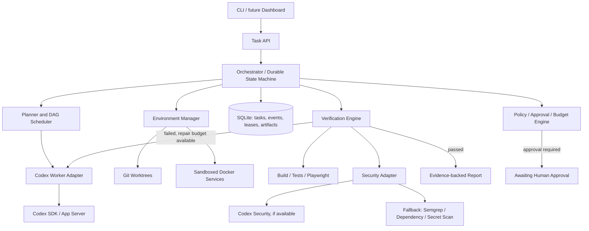
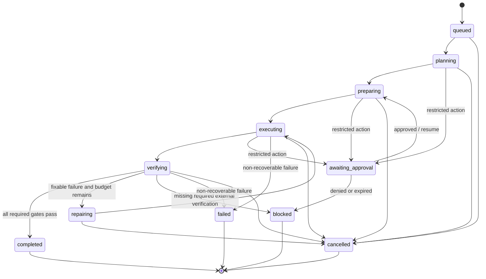

# Autonomous Codex Engineering Harness — Architecture

**Status:** Proposed architecture (MVP-first)  
**Primary language:** TypeScript / Node.js  
**Execution backend:** OpenAI Codex SDK initially; Codex App Server adapter later  
**Security:** Pluggable Codex Security integration, with independent fallback scanners

## 1. Purpose

Build a local-first autonomous software engineering harness that accepts a high-level engineering request, inspects a repository, plans work, executes changes with Codex, prepares disposable dependencies, verifies results, repairs failures within limits, runs security checks, and returns an evidence-backed completion report.

The harness must not claim a production integration works when it was only tested with mocks. It must not execute destructive, costly, or production-affecting actions without explicit approval.

### Non-goals for MVP

- Building a new coding model or replacing Codex's coding tools.
- A full web dashboard, distributed queue, or multi-host scheduler.
- Unbounded agent loops or automatic production deployments.
- Five parallel coding agents from day one.
- A bespoke vector database or mandatory Global Memory integration.

## 2. Design principles

1. **Orchestrator owns lifecycle:** Codex executes steps; the harness decides when a step is ready, passed, failed, blocked, or needs repair.
2. **Evidence over confidence:** Agent assertions never substitute for builds, tests, scans, and explicit acceptance checks.
3. **Bounded autonomy:** Permit routine sandboxed operations; gate destructive, external, expensive, or production actions.
4. **Crash safety:** Persist intent and state before side effects, and reconcile interrupted work on restart.
5. **Graceful degradation:** Use disposable local services and mocks where appropriate, but disclose unverified integrations.
6. **Replaceable adapters:** SDK/App Server, security scanners, environments, and knowledge providers must be swappable.
7. **Minimal model calls:** Deterministic diagnostics and recovery precede LLM-based troubleshooting.

## 3. High-level architecture



### Ownership boundaries

- **CLI:** Submit, inspect, resume, cancel, approve, and report; no orchestration logic.
- **Core:** Task state, scheduling, retry budgets, policies, checkpoints, reconciliation.
- **Agents:** Normalize Codex SDK/App Server session lifecycle and event streams.
- **Environment:** Worktrees, containers, process management, service detection, mock provisioning.
- **Verification:** Run checks, interpret evidence, enforce acceptance and security gates.
- **Persistence:** SQLite repositories, transactional state changes, event journal, artifact metadata.
- **Security:** Scanner adapters and normalized findings; unavailable scans are not passes.

## 4. Repository layout

```text
autonomous-harness/
├── apps/
│   ├── cli/src/
│   │   ├── index.ts
│   │   └── commands/{run,status,resume,logs,approve,cancel,diff,security}.ts
│   └── dashboard/                     # Phase 2, optional
├── packages/
│   ├── core/src/
│   │   ├── orchestrator.ts
│   │   ├── state-machine.ts
│   │   ├── scheduler.ts
│   │   ├── planner.ts
│   │   ├── recovery.ts
│   │   ├── policy.ts
│   │   ├── budgets.ts
│   │   └── types.ts
│   ├── agents/src/
│   │   ├── agent-adapter.ts
│   │   ├── codex-sdk.adapter.ts
│   │   ├── codex-app-server.adapter.ts # Phase 2
│   │   ├── context-builder.ts
│   │   └── prompts/
│   ├── security/src/
│   │   ├── security-adapter.ts
│   │   ├── codex-security.adapter.ts
│   │   ├── semgrep.adapter.ts
│   │   ├── dependency-scanner.ts
│   │   ├── secret-scanner.ts
│   │   └── findings.ts
│   ├── environment/src/
│   │   ├── workspace.ts
│   │   ├── git-worktree.ts
│   │   ├── docker.ts
│   │   ├── service-detector.ts
│   │   ├── mock-provider.ts
│   │   └── process-manager.ts
│   ├── verification/src/
│   │   ├── verifier.ts
│   │   ├── test-runner.ts
│   │   ├── build-runner.ts
│   │   ├── browser-runner.ts
│   │   └── acceptance.ts
│   ├── persistence/src/
│   │   ├── schema.ts
│   │   ├── database.ts
│   │   ├── task-repository.ts
│   │   ├── event-store.ts
│   │   ├── lease-repository.ts
│   │   └── checkpoint.ts
│   └── shared/src/{contracts,errors,logger}.ts
├── templates/{docker,mock-services,agent-instructions}/
├── tests/{unit,integration,e2e,fixtures}/
├── docs/
│   ├── ARCHITECTURE.md
│   ├── SECURITY.md
│   └── OPERATIONS.md
├── pnpm-workspace.yaml
├── package.json
└── tsconfig.json
```

Keep this structure as the target layout; implement only necessary files during the MVP.

## 5. Data contracts

```ts
type TaskStatus =
  | 'queued' | 'planning' | 'preparing' | 'executing'
  | 'verifying' | 'repairing' | 'awaiting_approval'
  | 'blocked' | 'completed' | 'failed' | 'cancelled';

type StepStatus = 'pending' | 'running' | 'passed' | 'failed' | 'blocked';

interface TaskRun {
  id: string;
  request: string;
  repositoryPath: string;
  workspacePath?: string;
  status: TaskStatus;
  planVersion: number;
  currentStepId?: string;
  maxRepairAttempts: number;
  remainingRepairAttempts: number;
  createdAt: string;
  updatedAt: string;
}

interface PlanStep {
  id: string;
  title: string;
  instructions: string;
  dependencies: string[];
  acceptanceCriteria: string[];
  status: StepStatus;
}

interface AgentAdapter {
  execute(input: {
    prompt: string;
    workspacePath: string;
    sessionId?: string;
    signal?: AbortSignal;
  }): Promise<{
    sessionId?: string;
    outcome: 'completed' | 'failed' | 'interrupted';
    summary: string;
    usage?: Record<string, number>;
  }>;
}

interface SecurityFinding {
  id: string;
  source: string;
  severity: 'critical' | 'high' | 'medium' | 'low';
  title: string;
  file?: string;
  line?: number;
  remediation?: string;
}

interface SecurityScanResult {
  status: 'passed' | 'findings' | 'unavailable' | 'error';
  findings: SecurityFinding[];
  coverage: string[];
  limitations: string[];
}
```

Validate all agent-produced plans and tool responses against runtime schemas. Reject cyclic or missing dependencies, unknown step IDs, and invalid transitions.

## 6. Execution lifecycle



### Step-by-step

1. **Receive:** Save user request, repo path, configuration, budgets, and permissions.
2. **Inspect:** Determine repository stack, scripts, tests, dependencies, existing changes, and sensitive paths. Never overwrite user changes.
3. **Plan:** Produce a dependency graph with acceptance criteria, risk levels, and verification commands.
4. **Prepare:** Create isolated worktree, allocate sandbox, detect required services, provision disposable alternatives where policy permits.
5. **Execute:** Start/resume Codex session, stream and persist events, collect changes and exit outcome.
6. **Verify:** Run formatting, type checking, builds, relevant tests, browser checks, and security scans as configured.
7. **Repair:** Feed concrete failures back to the same workstream, with bounded retries and no repeated identical unsuccessful action.
8. **Finalize:** Generate diff, evidence manifest, security findings, limitations, and completion status. Never equate a mock test with live integration validation.

### Crash recovery

- Record step intent and idempotency key before launching a process or agent turn.
- Use a lease with expiry and heartbeat for each active step.
- On restart, inspect existing processes, worktree, agent session, and artifacts before retrying.
- Reconcile an ambiguous side effect rather than blindly repeating it.
- Persist checkpoints at step boundaries and after significant environment changes.
- Never automatically retry a non-idempotent external action.

## 7. Planner and scheduling

The planner emits a schema-validated DAG. Each step specifies dependencies, working scope, acceptance criteria, and expected verification. The scheduler selects only pending steps whose dependencies have passed.

**MVP:** one active coding step at a time.  
**Phase 2:** independent steps in separate worktrees, then explicit integration and conflict resolution.

The orchestrator owns completion; Codex output is evidence to inspect, not authoritative task status.

## 8. Codex integration

### MVP: SDK adapter

Use `@openai/codex-sdk` to start or resume threads, stream events, and run tasks inside an isolated working directory. Persist session IDs and normalized events. Capture failures, cancellation, usage, and the final turn outcome.

Do not hardcode assumptions about SDK method signatures beyond the installed package version; check the SDK's current README/types when implementing.

### Later: App Server adapter

Use App Server when richer thread/turn/item lifecycle handling, approvals, interactive control, and concurrent sessions justify the extra protocol complexity. Keep the adapter interface stable so core orchestration does not change.

## 9. Security pipeline

```text
Changed files
  -> deterministic checks (secrets, dependencies, static analysis)
  -> Codex Security integration if accessible
  -> normalize and deduplicate findings
  -> triage by severity, confidence, exploitability
  -> targeted Codex remediation when policy allows
  -> rerun tests and scans
  -> report or request approval for unresolved risks
```

**Access note:** Codex Security availability, SDK/CLI entry points, and entitlements must be verified against the account and currently installed tooling. Do not assume ordinary Codex subscription access automatically includes Codex Security.

Fallback scanners (for example Semgrep, dependency audits, and secret scanning) provide independent coverage, not an equivalent replacement for Codex Security. Track source, coverage, errors, and unavailable checks. A scanner that did not run is never marked passed.

Security gates: block unresolved critical findings by default; high-severity findings require policy review. Never auto-apply a security fix to production. Redact credentials from logs and prompts.

## 10. Environment management and recovery

Use Git worktrees for change isolation **and** a container/sandbox for execution isolation. A worktree is not a security boundary.

Recovery registry examples:

| Failure | Allowed recovery | Verification |
|---|---|---|
| PostgreSQL connection refused | Start disposable local PostgreSQL | Health check and migration/test |
| Missing `.env` | Generate non-secret development placeholders | Configuration validation |
| Missing package | Install in sandbox using project package manager | Lockfile consistency and build |
| Port occupied | Allocate free local port | Service health check |
| Browser unavailable | Provision Playwright browser in sandbox | Smoke navigation |
| External API credentials absent | Use explicit mock for non-production tests | Mock contract tests; flag live integration unverified |
| Test failure | Targeted Codex repair | Re-run failed and relevant regression tests |

Recovery attempts must be budgeted and logged. Deterministic diagnostics should precede model calls. If recovery cannot be verified, mark the step blocked or failed with a reason.

## 11. Persistence

SQLite tables:

- `tasks`: request, lifecycle, budgets, configuration.
- `plans`: versioned plan and acceptance criteria.
- `steps`: dependencies, status, verification metadata.
- `attempts`: agent sessions, retries, outcomes, usage.
- `events`: append-only execution log with sequence numbers.
- `leases`: worker ownership and heartbeat expiry.
- `checkpoints`: resumable execution state.
- `resources`: managed containers, processes, ports, and cleanup status.
- `artifacts`: paths, checksums, and types of logs, diffs, screenshots, reports.
- `findings`: normalized security findings and dispositions.
- `approvals`: requested action, scope, actor decision, expiry.

Use transactions for state transitions and event insertion. Store large artifacts on disk and reference them by path and checksum.

## 12. Permission policy

Default profile: **balanced**.

**Allowed automatically inside an isolated sandbox:** repository inspection, changes to task worktree, dependency installation, disposable local services, routine test/build commands.

**Policy controlled:** network access, access to private repositories, external API usage, resource-intensive commands, and credential use.

**Require explicit approval:** production deploys, database deletion/migration against shared systems, purchases, external messages, irreversible operations, modifications outside allowed workspace, and secrets exposure.

Apply timeouts, CPU/memory limits, network restrictions, process cleanup, and maximum repair attempts. Treat repository instructions and tool output as untrusted with respect to permission escalation.

## 13. CLI contract

```bash
harness run "Implement authentication and user profiles" --repo .
harness status [task-id]
harness logs <task-id> --follow
harness resume <task-id>
harness approve <task-id> --request <approval-id>
harness cancel <task-id>
harness diff <task-id>
harness security <task-id>
```

These are proposed commands to implement, not built-in Codex commands.

## 14. MVP delivery plan

### Milestone 1 — Working coding loop
- Monorepo + CLI entry point.
- Codex SDK adapter and event capture.
- One task, one workspace, one coding attempt.
- Build/test verification and evidence report.

**Acceptance:** run a feature request against a fixture repo and capture an actual diff plus test results.

### Milestone 2 — Durable orchestration
- SQLite schema, validated planner, sequential DAG scheduler.
- State transitions, attempt budgets, event journal.
- Crash recovery with leases and reconciliation.

**Acceptance:** kill and restart orchestrator mid-task without corrupting the repo or duplicating side effects.

### Milestone 3 — Autonomous environment recovery
- Docker and worktree manager.
- Deterministic failure classifiers.
- Local PostgreSQL and mock-service templates.
- Recovery verification and limitations reporting.

**Acceptance:** fixture app with unavailable DB recovers using disposable local service and passes tests.

### Milestone 4 — Security gate
- Security adapter interface.
- Available Codex Security integration and fallback scanners.
- Findings triage, remediation loop, rescan.

**Acceptance:** seeded detectable vulnerability is reported or fixed; unavailable scanner is never marked passed.

### Milestone 5 — Hardening
- Resource cleanup, cancellation, approvals, timeout policies.
- Integration tests for repeated failures and missing credentials.
- Usage/cost reporting and final artifact manifest.

**Acceptance:** all end-to-end scenarios below pass reliably.

## 15. End-to-end test matrix

| Scenario | Required result |
|---|---|
| Implement simple feature | Diff + passing build and tests |
| DB initially unavailable | Disposable DB provisioned and tested |
| Failing test introduced | Targeted repair within configured budget |
| Orchestrator killed mid-run | Safe reconciliation and resume |
| Vulnerability introduced | Finding recorded, fix or explicit gate |
| Security backend unavailable | Clearly reported as unavailable |
| Missing external API key | Mock tests only, live integration flagged unverified |
| Destructive command requested | Explicit approval required |
| Repair budget exhausted | Stops with actionable failure report |

## 16. Completion report schema

Each task must return:

- **Outcome:** completed, blocked, failed, or cancelled.
- **Implemented:** summary of actual changes and commit/diff reference.
- **Verification:** each check, command, status, duration, and evidence artifact.
- **Security:** scanners run, findings, exceptions, and unavailable coverage.
- **Environment:** real versus mocked dependencies and resources provisioned.
- **Limitations:** unverified integrations and unresolved issues.
- **Usage:** elapsed time, agent turns, retries, and available token/cost metrics.
- **Next actions:** only items requiring user decision or follow-up.

## 17. Initial implementation order

1. Scaffold pnpm workspace and CLI.
2. Implement `AgentAdapter` and Codex SDK backend.
3. Build the smallest run → test → repair → report loop.
4. Add SQLite state and event persistence.
5. Add planner, DAG validation, and sequential scheduler.
6. Add worktrees, sandboxed execution, and local service recovery.
7. Add policy approvals and security adapters.
8. Test crash recovery and all end-to-end scenarios.

**First vertical slice:** `user request → Codex changes → tests → bounded repair → evidence-backed report`.

## 18. References

- Codex repository: https://github.com/openai/codex
- Codex TypeScript SDK: https://github.com/openai/codex/tree/main/sdk/typescript
- Codex documentation: https://developers.openai.com/codex/

Verify current Codex Security integration documentation and account entitlement before implementing its adapter.
