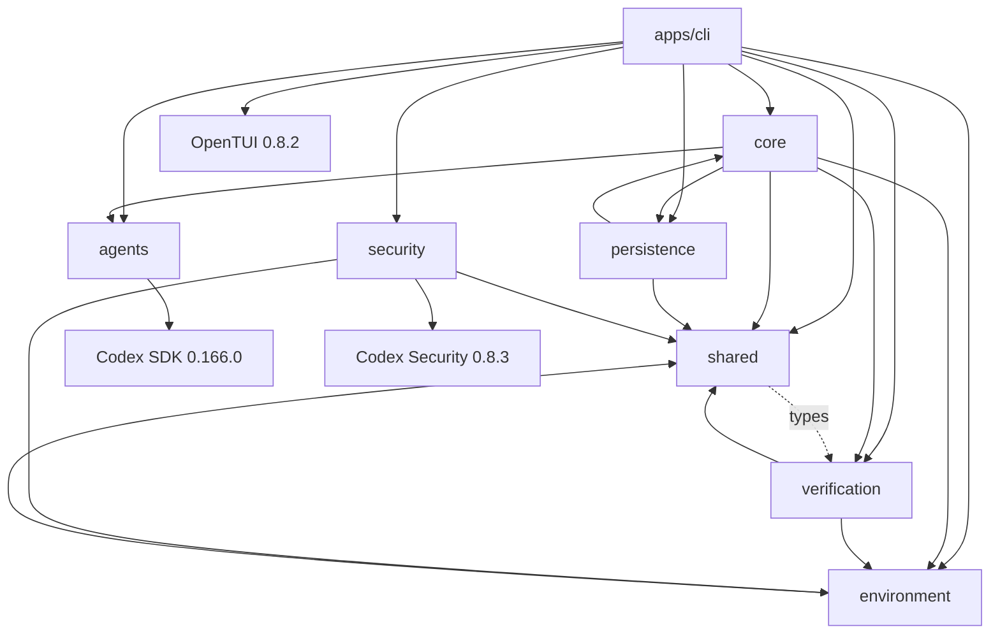

# Phase 00 repository audit

Audited 2026-11-06 against `486aa44720de928cffda8b080681f26867045d0a`. Product authority: [master roadmap](../../CTX_Autonomous_Orchestration_Master_Roadmap.md), especially Phase 00 and section 22. This report describes observed code and checks, not V1 completion.

## Safety snapshot

The worktree was clean at audit start. `checkpoint/pre-roadmap-audit-20261106` preserves the baseline commit; audit work is on `roadmap/p00-baseline-audit`. Creating these refs required approval because `.git` is read-only in the sandbox. Existing ignored release bundles, node_modules and prior `.harness` evidence were retained. Normal builds regenerate ignored `dist`; the Docker probe added a new task/evidence directory. No source behavior was rewritten and no existing tests were removed.

## Inventory and ownership

The root compiler builds all apps, packages and tests together into `dist`, with strict TypeScript and NodeNext modules. Eight child workspace packages plus the root are recognized by pnpm. Child package manifests are mostly labels, with no independent build scripts or declared internal dependency graph. Root dependencies and source imports determine actual behavior. [Machine-readable inventory](../verification/phase-00/inventory.json) lists files and imports.

| Area | Actual responsibility | Recommendation |
| --- | --- | --- |
| `apps/cli` | `index.ts` command parsing; `terminal.ts` controller starts tasks; screen/plain surfaces, model, preferences, journal projection and doctor | Retain UI and projections; refactor task commands behind a service interface, then daemon IPC in P08. |
| `packages/core` | `runTask`/`resumeTask`, plans, state machine, next-step selection, repair decisions, verified apply | Retain runner/verification gates; refactor neutral contracts and extract a true task scheduler. |
| `packages/persistence` | SQLite schema v2, JSON tasks/plans/steps/attempts, event/checkpoint journaling, process leases, artifact metadata | Retain transactional repository; refactor migrations, domain coupling, claims, backups and task-level queue data in P02/P03. |
| `packages/agents` | `AgentAdapter.execute`, Codex SDK streaming, session continuation and abort signal | Retain tested integration; normalize harness-independent events/errors in P01/P04. Defer OpenCode to P10. |
| `packages/environment` | Private snapshots/worktrees, process groups, timeout/cancel, Docker resources and access diagnostics, service detection/provisioning | Retain safeguards and bounded recovery; extend registration/cleanup/resource policy through P05/P07. |
| `packages/verification` | Immutable policy, requirement planning, filesystem/HTML/command/browser checks, independent result gate | Retain behavior and failure tests; separate portable result types from implementation imports. |
| `packages/security` | Explicit subprocess Codex Security scan, normalized findings and allowlisted environment | Retain optional adapter; add configured general scanner coverage in P06. No live entitlement established. |
| `packages/shared` | Report/check contracts and redaction | Retain redaction; replace cross-package type coupling with neutral domain contracts in P01. |
| `scripts`, `templates`, `releases` | Launch/package/relocation/install checks; disposable service templates; existing Linux runtime bundle | Retain; defer release hardening and macOS support to P16. Do not rebuild/reinstall releases as part of this audit. |

## Actual dependency graph

Edges include type-only imports. The core/persistence reverse edge includes a runtime state-machine import; shared/verification reverse edges include import types. Distinguish source-level coupling from runtime cycles.

## Execution and persistence

1. CLI `run` or a terminal request calls `runTask` directly. Input limits, plan and immutable verification policy resolve before a queued task is stored.
2. `TaskStore` opens `<output> / harness.sqlite` (normally project `.harness/harness.sqlite`). WAL, FULL synchronization, foreign keys and a 5s busy timeout are configured. Schema v2 contains tasks, plans, steps, attempts, events, leases, checkpoints, resources and artifacts.
3. The same calling process immediately claims and executes that task. A UUID owner, PID/host and expiry gate updates; a heartbeat renews the lease. Explicit `resumeTask` reconciles interrupted work. Recovery tests kill/restart fixture workers and protect against duplicate claims.
4. Source content is copied to a private snapshot outside the source, excluding `.git`, `node_modules`, and `.harness`; symlinks are rejected. A detached Git worktree is made from the private baseline. This is not yet a task branch based on the registered source repository's commit history.
5. Environment policy selects filesystem, Docker or explicitly authorized host execution. Docker application checks use owned labels, internal networking and restricted resources. Host fallback, image pulls and dependency installation require explicit policy.
6. Codex runs through the installed TypeScript SDK, using workspace-write, no network/web search, and approval policy `never`. Thread IDs, raw SDK events, results and usage are journaled. Independent verification, bounded repair, diff/manifest generation and final evidence determine the outcome.
7. CLI/TUI read the DB for status and projections. TUI polls every 250ms while executing and keeps display entries/settings plus an in-memory abort controller. This is derived progress plus client-owned execution state, not a separate durable queue. Closing the UI does not provide the planned always-on supervisor.

Current task states: queued, planning, preparing, executing, verifying, repairing, awaiting_approval, blocked, completed, failed, cancelled. `blocked` is terminal to the current runner. `scheduler.ts` selects a pending **step** whose step dependencies passed; it has no cross-task DAG, capacity state, persisted wake deadline or concurrency controller.

`TaskStore` uses synchronous SQLite, and core reads/hashes artifacts synchronously in several execution paths (`readFileSync`). Journal checkpoints serialize the full growing task record on each event. These are acceptable observations for the single-task baseline but can delay heartbeats/UI under larger artifacts or streams; measure and bound them before concurrent daemon operation. External commands use async spawning; the process supervisor sends signals to process groups and bounds output.

## Commands and test coverage

CLI: default/UI, help/version, doctor, login, security, run, status, resume, logs, diff, apply preview/confirm. Terminal commands also provide task selection, cancellation, retry-host policy, settings and minimal/detailed modes. There is no durable submit-only queue, daemon command, remote command bus or authenticated ingress.

Root scripts: `build`, `typecheck`, `test`, `harness`, `ctx`, `release`, `release:check`, `test:live`, `test:docker`, `test:tui`, `test:engineering-live`. Normal tests use fake adapters/drivers plus real local Git/process/filesystem/SQLite commands. Five live cases are opt-in: four real Codex tasks and one real Docker/PostgreSQL fixture. Real model tasks were not started during this audit. OpenTUI has four separate native-renderer tests. Release checks are a separate packaging concern, not revalidated here.

Detailed current outcomes and reproduction commands are in the [baseline report](../verification/phase-00/REPORT.md). Earlier `EXECUTION_VERIFICATION.md` is historical evidence; its 98-pass count and stale-group diagnosis must not substitute for this run.

## Compatibility and security findings

Local versions: Node 22.22.1, pnpm 12.16.1, Codex CLI/SDK 0.166.0, OpenCode 2.2.5, OpenTUI 0.8.2, Docker CLI 29.9.2, Git 2.53.0, SQLite 3.46.1 via `node:sqlite`, Linux 7.0.0-42-generic. No standalone sqlite3 CLI was found. Existing bundled UI runtime reports Node 26.4.0. Exact SDK/tool probes: [versions.json](../verification/phase-00/versions.json); OpenCode's approved probe returned `opencode v2.2.5` after its normal log path was denied by the sandbox.

The installed security SDK is real. `worker.ts` calls `CodexSecurity.run`, validates completed status and emits normalized findings. Adapter tests inject results and exercise malformed/cancelled/timeout handling; those are mocked transport tests. `--check` and doctor prove imports/prerequisites, not scan access. Core task reports label security unavailable; a standalone scan is not automatically attached to every task. Configured required security commands are independently enforced by verification.

Auth readiness was checked without reading or printing credential files. Account readiness does not establish quota, billing, OpenCode model access or security entitlement. Laptop sleep policy, actual logout/service operation, macOS compatibility, Discord credentials/allowlists and MCP permissions remain unverified future setup requirements.

## Prioritized implementation debt

| ID | Priority / phase | Work and proof needed |
| --- | --- | --- |
| P00-ENV-01 | Optional fixture prerequisite | Authorized Docker access works, but `postgres:16-bookworm` is absent. Preload approved fixture images, then rerun `pnpm test:docker`; do not bypass checks or grant socket access. See baseline report. |
| ARCH-01 | P01 | Neutral versioned task/checkpoint schema and runtime validation, command/error/config contracts; remove core/persistence runtime cycle and shared/verification type cycle. |
| DUR-01 | P02 | Project registration, task dependencies, inbox/outbox, exact-action approvals, capacity state, migration backups, atomic submission/deduplication and CAS tests. Current JSON deserialization is a cast, not runtime validation. |
| SCHED-01 | P03 | True task DAG queue, bounded concurrency, safe retry/pause/cancel, lease fencing and persisted next-run deadlines. Demonstrate fake-worker restart/concurrent-claim behavior across 15 tasks. |
| ADAPT-01 | P04/P07 | Canonical worker events and failure taxonomy, structured quota signals, portable checkpoint and bounded recovery handoff. Existing adapter emits SDK event names and generic failure summaries. |
| VERIFY-01 | P06 | General security fallback and durable evidence coverage; optional Codex scan entitlement remains unproved. |
| DAEMON-01 | P08 | Single execution owner, authenticated IPC, idle lifecycle and restartable timers; migrate UI execution ownership. |
| V1-01 | P09–P16 | Discord, OpenCode integration, capacity routing, MCP boundary, batch integration, endurance, operational packaging and platform demonstrations. These are absent or unverified, not implied by the baseline. |

## Phase 01 implementation map

Implement Phase 01 as a separate branch after review of this audit. Preserve serialized legacy tasks while introducing versioned contracts; do not rename persisted states without a migration strategy.

| Requirement | Expected files / bounded work | Verification |
| --- | --- | --- |
| P01-01/02/07 | New `packages/shared/src/domain.ts`, `validation.ts`, `errors.ts`; adapt existing contracts/types with compatibility exports | Valid/invalid task and checkpoint fixtures, unknown versions, actionable typed errors, strict build. |
| P01-03/04 | Move pure transition contracts to a neutral module; update `core/src/state-machine.ts` and persistence imports | Full transition matrix, regression suite, static dependency graph without new cycles. |
| P01-05 | New typed `packages/core/src/commands.ts` interface for submit/cancel/pause/resume/approve/retry/query | Typecheck command/result exhaustiveness; no premature daemon or fake implemented handlers. |
| P01-06 | New `packages/core/src/config.ts`, neutral config schema and safe resolver | Invalid config, precedence, exact repo paths and redaction tests; no credential values in evidence. |
| P01-08/09 | Decision records, package ownership map, `tests/unit/domain.test.ts`, `config.test.ts`, transition tests | Malformed inputs fail before worker start; existing CLI/TUI/runner tests stay green. |

Package splitting is optional until boundaries are stable. Keep current working modules and avoid a CLI rewrite. Phase 01 exit evidence must cover its complete contract/validation gate; this audit does not grant a pass to any later phase.
